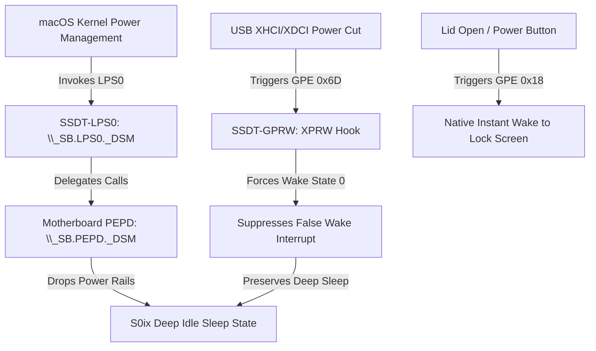

# Dell Inspiron 15 7510 Hackintosh (Tiger Lake-H)

[](https://github.com/acidanthera/OpenCorePkg)
[](https://www.apple.com/macos/)
[](https://ark.intel.com/)
[](https://github.com/b00t0x/WhateverXe)
[-success.svg)](https://github.com/skmaiti2050/Dell-Inspiron-7510-Hackintosh)
[](https://github.com/skmaiti2050/Dell-Inspiron-7510-Hackintosh)
[](https://github.com/b00t0x/WhateverXe-Graphics)

A complete, battle-tested OpenCore **1.0.8** EFI configuration for the **Dell Inspiron 15 7510** (Intel Core i5-11400H Tiger Lake-H / HM570) running **macOS Tahoe 26.7.1**.

This build serves as a stable daily driver featuring **Metal 2 GPU acceleration** via WhateverXe, **native Modern Standby (S0ix / Deep Idle)** sleep and wake (lid close/open & power button), **built-in digital microphone array** (Intel SST / cAVS 2.5 DSP) with Apple Voice Isolation, **4K external display** (HDMI & USB-C DP Alt Mode), native Wi-Fi, Bluetooth, battery management, and precision I2C trackpad gestures.

> [!CAUTION]
> **Generate Your Own SMBIOS Identifiers Before Booting!**
> This repository is distributed without personal platform identifiers. The `config.plist` contains placeholder values (`FILL-ME-SERIAL`, `FILL-ME-MLB`, zeroed UUID and ROM). You **must** generate unique SMBIOS keys (`MacBookPro16,2`) using [GenSMBIOS](https://github.com/corpnewt/GenSMBIOS) before booting to avoid iCloud and Apple services lockouts.

---

## Table of contents

- [Hardware tested](#hardware-tested)
- [Software versions](#software-versions)
- [What works](#what-works)
- [Known limitations](#known-limitations)
- [Repository layout](#repository-layout)
- [BIOS settings](#bios-settings)
- [Installation](#installation)
- [Post-install](#post-install)
- [Sleep and Modern Standby (S0ix)](#sleep-and-modern-standby-s0ix)
- [Display and Thunderbolt 4 architecture](#display-and-thunderbolt-4-architecture)
- [Verification commands](#verification-commands)
- [ACPI and DSDT patches](#acpi-and-dsdt-patches)
- [Kexts overview](#kexts-overview)
- [Boot arguments](#boot-arguments)
- [Updating macOS or WhateverXe](#updating-macos-or-whateverxe)
- [Credits](#credits)
- [License & Disclaimer](#license--disclaimer)

---

## Hardware tested

| Component | Specification |
|---|---|
| **Model** | Dell Inspiron 15 7510, BIOS **1.38.0**, Intel HM570 Chipset |
| **CPU** | Intel Core **i5-11400H** (Tiger Lake-H, 6C/12T, 2.7–4.5 GHz) — spoofed as Ice Lake (`Cpuid1Data E5060700`) |
| **iGPU** | Intel UHD Graphics **`8086:9A68`** (Xe-LP, 32 EU, TGL-H GT1), DVMT **64 MB** |
| **dGPU** | NVIDIA GeForce RTX 3050 Laptop **`10DE:25A2`** (4 GB GDDR6) — powered off via `SSDT-dGPU-Off` |
| **RAM** | **16 GB** DDR4-3200 (Dual-channel) |
| **Internal Panel** | 15.6" Full HD **1920×1080 @ 60 Hz** (BOE NV156FHM-N4W eDP) |
| **Storage** | KIOXIA KBG40ZNS512G NVMe SSD (Internal ESP `disk0s1`) |
| **Wi-Fi / BT** | Intel Wi-Fi 6 **AX201** (CNVi `8086:43F0`, Bluetooth USB `8087:0026`) |
| **Audio** | Realtek **ALC236** behind Intel cAVS 2.5 DSP (`8086:43C8`) |
| **Digital Mic** | Built-in Dual Digital PDM Microphone Array behind Intel SST / SOF DSP (`8086:43C8`) |
| **Trackpad** | I²C HID **`DLL0A81`** on `\_SB.PC00.I2C1.TPD0` (precision multi-touch gestures) |
| **Keyboard** | Internal PS/2 Keyboard with function keys and 2-stage white backlight |
| **Webcam** | Built-in 720p HD Webcam with privacy shutter (internal USB 2.0 port) |
| **Card Reader** | Realtek USB 2.0 SD Card Reader (Internal USB port) |
| **Thunderbolt / USB-C** | Intel Tiger Lake TCSS xHCI (`8086:9A17`) + USB-C with USB-PD & DisplayPort Alt Mode |

**SMBIOS:** `MacBookPro16,2` with CPUID spoofed to Ice Lake-U (`0x0607E5`).

---

## Software versions

| Software / Component | Tested Version | Purpose |
|---|---|---|
| **macOS** | **Tahoe 26.7.1** | Operating system |
| **OpenCore** | **1.0.8 RELEASE** | Bootloader (GoldenGate GUI, AudioDxe boot chime) |
| **Lilu** | **1.7.2** | Kernel patcher framework |
| **WhateverXe** | **0.7.0** (`gputicks-bootarg` build) | Intel Tiger Lake-H Xe-LP graphics driver |
| **WhateverXe-Graphics** | **0.4.0** | Metal 2 driver & GPU acceleration framework |
| **AMFIPass** | **1.4.1 Mod** (b00t0x) | AMFI bypass required by WhateverXe Graphics |
| **VirtualSMC** | **1.3.8** | SMC emulator (`SMCBatteryManager`, `SMCProcessor`, `SMCDellSensors`) |
| **TGLDmic** | **0.5.0** (`sof-tgl-h.ri` v2.2) | Intel SST DMIC driver for Tiger Lake-H |
| **AirportItlwm** | **2.4.0 alpha** (laobamac Tahoe build) | Native macOS Wi-Fi menu and WPA2 connectivity |
| **IntelBluetoothFirmware** | **2.5.3** (lshbluesky) + **IntelBTPatcher** | Intel AX201 Bluetooth firmware and pairing fix |
| **BlueToolFixup** | **2.7.2** | macOS Bluetooth stack integration |
| **VoodooHDA** | **3.6.8** (release 368) | Audio engine (installed in `/Library/Extensions`) |
| **VoodooI2C / VoodooI2CHID** | **2.9.1** | Precision trackpad multi-touch gestures |
| **VoodooPS2Controller** | **2.3.7** | PS/2 keyboard plugin |
| **BrightnessKeys** | **1.0.3** | Fn brightness keys (F6/F7) via ACPI EC queries |
| **USBToolBox / UTBMap** | **1.2.0** | Tailored 15-port ACPI USB mapping for Inspiron 7510 |
| **NVMeFix** | **1.1.3** | NVMe autonomous power state transitions |
| **ECEnabler** | **1.0.6** | Multi-byte Embedded Controller field support |

---

## What works

| Feature | Status | Implementation Details |
|---|---|---|
| **Graphics Acceleration** | ✅ **Metal 2** | WhateverXe 0.7.0 (with `-wex-skip-gputicks`) + WhateverXe Graphics 0.4.0; 1536 MB VRAM, 30-bit color, HiDPI scaling, smooth WindowServer |
| **Sleep & Wake** | ✅ **Native S0ix** | **Modern Standby (S0ix / Deep Idle)** via `SSDT-LPS0` (delegating to motherboard `PEPD._DSM`) + `SSDT-GPRW` instant-wake suppression. Native clamshell lid close/open and power button wake verified |
| **Internal Mic Array** | ✅ **Native** | Intel SST DMIC array (cAVS 2.5 DSP `8086:43C8`) via `TGLDmic.kext` 0.5.0 + `TGLDmic.driver` CoreAudio HAL plug-in. 48 kHz stereo capture with Apple Voice Isolation |
| **Audio Output** | ✅ **Working** | Realtek ALC236 speakers and 3.5 mm headphone output via VoodooHDA 3.6.8 in `/Library/Extensions` with volume fix; Bluetooth & USB audio native |
| **Internal Display** | ✅ **Working** | Full 1920×1080 @ 60 Hz with smooth native brightness slider and Fn keys |
| **External Display (USB-C)** | ✅ **4K @ 60 Hz** | DisplayPort Alt Mode over USB-C runs full 4K (3840×2160) @ 60 Hz with monitor set to USB 2.0 mode (4 uncompressed DP lanes) |
| **External Display (HDMI)** | ✅ **4K @ 30 Hz** | Native HDMI port provides 4K @ 30 Hz (HDMI 1.4 PHY bandwidth limit) |
| **Monitor Brightness (DDC)** | ✅ **Working** | MonitorControl 4.4 controls external display brightness and volume over HDMI and USB-C DDC/CI |
| **Wi-Fi** | ✅ **Working** | Native macOS Wi-Fi menu bar item, 2.4 GHz and 5 GHz WPA2 networks via AirportItlwm-Tahoe |
| **Bluetooth** | ✅ **Working** | Intel AX201 Bluetooth with A2DP/HFP audio, BLE keyboards, and mice |
| **Touchpad & Gestures** | ✅ **Native** | I2C precision multi-touch with smooth tracking, tap-to-click, and macOS gestures via VoodooI2C (`-vi2c-force-polling` + Ice Lake-LP spoof) |
| **Keyboard & Backlight** | ✅ **Working** | Full PS/2 keyboard with 2-level backlight control, Fn brightness/media keys |
| **Battery & Power** | ✅ **Working** | Accurate battery percentage, wattage telemetry, cycle count, AC adapter status (`SMCBatteryManager`) |
| **Webcam & Card Reader** | ✅ **Working** | Built-in 720p HD webcam and Realtek SD card reader operate across mapped USB ports |
| **dGPU Power Off** | ✅ **0 W Draw** | NVIDIA RTX 3050 completely powered down via `SSDT-dGPU-Off` (`PEG1.PG01._OFF`), maximizing battery life |
| **OpenCore Boot GUI** | ✅ **Working** | GoldenGate graphical boot picker, AudioDxe startup chime (`--force-device`), NVRAM clean tools |

---

## Known limitations

| Limitation | Cause / Technical Background | Recommended Workaround |
|---|---|---|
| **USB-C 4K60 + USB 3.0 Data** | BenQ/Dell monitors with internal USB 3 hubs allocate 2 DP lanes for 5 Gbps data and 2 lanes for DP. 4K on 2 lanes mandates Display Stream Compression (DSC), which Apple never implemented in macOS Intel drivers. | Switch monitor OSD setting to **USB 2.0 Mode** (allocates all 4 lanes to DisplayPort for uncompressed 4K60). |
| **3.5 mm Headset Mic** | ALC236 headset combo jack requires custom Dell codec verbs unsupported by VoodooHDA. | Use the built-in digital microphone array (TGLDmic) or USB/Bluetooth headsets. |
| **HDMI / DP Audio** | macOS Tahoe lacks AppleHDA; AppleGFXHDA cannot share the DSP controller with VoodooHDA. | Audio routes through laptop speakers, 3.5 mm headphones, or USB/Bluetooth audio. |
| **AirDrop / AWDL / Sidecar** | Apple AWDL / Continuity features rely on Broadcom/Apple wireless chipsets and are not implemented in AirportItlwm for 26.5+. | Use local network sharing, iCloud Drive, or cable tethering. |
| **Fingerprint Reader** | Power button Goodix fingerprint reader has no macOS driver. | Enter password or use Apple Watch unlock. |

---

## Repository layout

```
Dell-Inspiron-7510-Hackintosh/
├── EFI/
│   ├── BOOT/
│   │   └── BOOTx64.efi              # OpenCore Boot loader
│   └── OC/
│       ├── ACPI/                    # Compiled AML tables (S0ix, GPRW, PNLF, etc.)
│       ├── Drivers/                 # OpenRuntime, AudioDxe, OpenCanopy
│       ├── Kexts/                   # Kernel extensions (Lilu, WhateverXe, etc.)
│       ├── Resources/               # Audio chime and GoldenGate icons
│       ├── Tools/                   # OpenShell.efi, CleanNvram.efi
│       └── config.plist             # Production OpenCore configuration (anonymized)
├── ACPI-sources/                    # Human-readable DSL source files
│   ├── SSDT-LPS0.dsl                # Native S0ix Modern Standby PEPD delegation
│   ├── SSDT-GPRW.dsl                # Instant wake suppression for GPE 0x6D
│   ├── SSDT-dGPU-Off.dsl            # Powers off discrete NVIDIA RTX 3050
│   ├── SSDT-PNLF.dsl                # Tiger Lake backlight interface (UID 19)
│   ├── SSDT-XOSI.dsl                # Windows 10 OS feature flag injection
│   ├── SSDT-GPI0.dsl                # Clears GPHD to expose I2C GPIO pins
│   ├── SSDT-EC-USBX.dsl             # Embedded Controller & USB power definition
│   └── SSDT-AWAC.dsl                # Forces legacy RTC clock mode
├── extras/
│   ├── TGLDmic/                     # Digital Microphone HAL plug-in & installer
│   │   ├── install-hal.sh           # Installs TGLDmic.driver to CoreAudio HAL
│   │   ├── uninstall-hal.sh         # Uninstalls plug-in and restarts coreaudiod
│   │   └── TGLDmic.driver           # Native 64-bit CoreAudio HAL bundle
│   ├── DisplayOverride-BenQ-PD2706UA # EDID override for BenQ 4K monitor (RGB color mode)
│   └── DisplayOverride-BOE-NV156FHM-N4W # EDID override to name internal laptop display
└── README.md                        # Documentation
```

---

## BIOS settings

Reboot your Dell laptop and press **F2** repeatedly to enter BIOS Setup. Configure the following options:

| Category | Setting | Required Value | Explanation |
|---|---|---|---|
| **Storage** | SATA/NVMe Operation | **AHCI / NVMe** | macOS does not support Intel RST Premium / VMD RAID |
| **Boot Configuration** | Secure Boot | **Disabled** | Required to load OpenCore and unsigned EFI binaries |
| **Video** | DVMT Pre-Allocated | **64 MB** (Default) | Injected via `framebuffer-stolenmem 0000C003` |
| **Virtualization** | Intel VT-d | **Disabled** (or Enabled) | Set to Disabled, or keep enabled with `DisableIoMapper = true` |
| **Power** | Block Sleep | **Disabled** (OFF) | Allow hardware to enter Modern Standby states |
| **Security** | Intel Platform Trust (TPM) | **Enabled** or **Disabled** | Does not affect macOS boot |
| **POST Behavior** | Fastboot | **Thorough** | Ensures full PCIe and USB bus enumeration on cold boot |

---

## Installation

### 1. Prepare USB Installer
1. Create a macOS Tahoe bootable USB drive using standard recovery or offline image methods.
2. Format the USB EFI partition as FAT32.
3. Copy the `EFI` directory from this repository to the USB EFI partition (`/Volumes/EFI/EFI/`).

### 2. Generate SMBIOS Identifiers
1. Open the repository's `EFI/OC/config.plist` using [ProperTree](https://github.com/corpnewt/ProperTree).
2. Run [GenSMBIOS](https://github.com/corpnewt/GenSMBIOS) and generate keys for model **`MacBookPro16,2`**.
3. Fill in the following fields under `PlatformInfo → Generic`:
   - `SystemProductName` = `MacBookPro16,2`
   - `SystemSerialNumber` = *Your generated Serial*
   - `MLB` = *Your generated Board Serial*
   - `SystemUUID` = *Your generated SmUUID*
   - `ROM` = *Your real Wi-Fi or Ethernet MAC address (12 hex digits)*
4. Save `config.plist`.

### 3. Install macOS
1. Boot from the USB drive and select **macOS Installer** in the OpenCore picker.
2. Format your NVMe drive as **APFS** with **GUID Partition Map** using Disk Utility.
3. Complete the macOS installation (the machine will restart 2–3 times).

### 4. Deploy EFI to Internal NVMe ESP
After reaching the macOS desktop, mount your internal drive's EFI partition and copy the configuration:
```bash
sudo diskutil mount disk0s1
sudo cp -R /Volumes/EFI/EFI /Volumes/EFI-1/
```
*(Ensure `OpenCore.efi` is enrolled in Dell BIOS boot sequence as a trusted boot option).*

---

## Post-install

The following post-installation steps are required to achieve a complete, accelerated system.

### A. Graphics Acceleration (WhateverXe Graphics)
On first boot, the system runs with basic firmware framebuffer rendering. To activate Metal 2 acceleration:
1. Download **`WhateverXe-Graphics-0.4.0.pkg`** from [b00t0x/WhateverXe-Graphics releases](https://github.com/b00t0x/WhateverXe-Graphics/releases).
2. Install the package:
   ```bash
   sudo installer -pkg WhateverXe-Graphics-0.4.0.pkg -target /
   ```
3. Restart your laptop.
4. Verify Metal 2 acceleration:
   ```bash
   system_profiler SPDisplaysDataType | grep -E "Chipset Model|Metal Support|VRAM"
   ```
   *Expected output:* `Chipset Model: Intel UHD Graphics`, `Metal Support: Metal 2`.

### B. Internal Digital Microphone Array
The built-in dual digital microphone is connected directly to the Intel SST / cAVS 2.5 DSP (`8086:43C8`).
1. Navigate to the `extras/TGLDmic` directory in this repository:
   ```bash
   cd extras/TGLDmic
   sudo bash install-hal.sh
   ```
2. The script installs `TGLDmic.driver` to `/Library/Audio/Plug-Ins/HAL/` and restarts `coreaudiod`.
3. Open **System Settings > Sound > Input** and select **Internal Microphone (TGLDmic)**.
4. When using FaceTime, Zoom, or voice calls, select **Voice Isolation** from the macOS Control Center for background noise suppression.

### C. Internal Speakers and Headphone Jack
macOS Tahoe has retired legacy AppleHDA, so AppleALC cannot bind natively.
1. Download **VoodooHDA 3.6.8** (release 368) from [CloverHackyColor/VoodooHDA](https://github.com/CloverHackyColor/VoodooHDA/releases).
2. Install `VoodooHDA.kext` into `/Library/Extensions/`:
   ```bash
   sudo cp -R VoodooHDA.kext /Library/Extensions/
   sudo chown -R root:wheel /Library/Extensions/VoodooHDA.kext
   sudo chmod -R 755 /Library/Extensions/VoodooHDA.kext
   sudo kmutil load -p /Library/Extensions/VoodooHDA.kext
   ```
3. Approve the kernel extension in **System Settings > Privacy & Security** and reboot.

### D. External Display Configuration (HDMI & USB-C)
- **External HDMI**: Operates at 4K @ 30 Hz. If your monitor displays washed-out colors (YCbCr CEA mode), copy `extras/DisplayOverride-BenQ-PD2706UA` to `/Library/Displays/Contents/Resources/Overrides/` to force full-range RGB.
- **External USB-C (DisplayPort Alt Mode)**: Set your monitor's USB-C hub setting to **USB 2.0** to allocate all 4 DisplayPort lanes, providing flawless **4K @ 60 Hz**.
- **Display Brightness & Volume (DDC/CI)**: Install [MonitorControl](https://github.com/MonitorControl/MonitorControl) to adjust external monitor brightness and volume using native Apple keyboard keys.

---

## Sleep and Modern Standby (S0ix)

The Dell Inspiron 15 7510 (BIOS 1.38.0) uses Intel Modern Standby firmware architecture without legacy S3 power planes (`SS3 = Zero`). On macOS, standard sleep previously resulted in instant wakes or kernel freezes.

This EFI includes a complete, verified solution for native macOS Modern Standby:



### 1. Motherboard PEPD Delegation (`SSDT-LPS0.aml`)
The Dell DSDT contains a fully implemented Intel Modern Standby state machine under `\_SB.PEPD` (UUID `c4eb40a0-6cd2-11e2-bcfd-0800200c9a66`), controlling subsystem low-power modes (Functions 0–6). macOS expects device `\_SB.LPS0`. `SSDT-LPS0.aml` creates `\_SB.LPS0` and forwards all requests directly into `\_SB.PEPD._DSM`.

### 2. Instant-Wake Suppression (`SSDT-GPRW.aml`)
When entering S0ix, the Intel Tiger Lake TCSS and USB controllers cut bus power, which triggers GPE `0x6D` (`kern.wakereason: XDCI XHCI`) and causes an instant wake after 15 seconds.
`SSDT-GPRW.aml` coupled with OpenCore DSDT renames (`GPRW(2,N) → XPRW` and `UPRW(0,N) → XPRW`) suppresses GPE `0x6D` wake assertions during sleep, allowing clean, uninterrupted deep sleep.

### 3. Tested Sleep Results
- **Clamshell Sleep**: Closing the laptop lid puts the system into deep sleep immediately.
- **Lid Open Wake**: Opening the lid wakes the display and camera instantly without touching the power button.
- **Power Button Wake**: Pressing the power button wakes the system cleanly to the login screen.
- **Standby Power Draw**: Drops package power to idle rails (~3–5W trickle draw).

---

## Display and Thunderbolt 4 architecture

The Dell Inspiron 15 7510 is equipped with a Tiger Lake-H Type-C / Thunderbolt 4 port routed through the Intel Tiger Lake TCSS xHCI controller (`8086:9A17`).

### External Monitor Link Modes (BenQ PD2706UA & Similar 4K Displays)
| Monitor USB-C Mode | DP Lanes Allocated | USB Speed | 4K Max Refresh Rate | macOS Compatibility |
|---|---|---|---|---|
| **USB 2.0 Mode (4 DP Lanes)** | **4 Lanes** | USB 2.0 (480 Mbps) | **4K @ 60 Hz** | ✅ **Full Native Support** (Recommended) |
| **USB 3.0 Mode (2 DP Lanes)** | **2 Lanes** | USB 3.2 Gen 1 (5 Gbps) | 4K @ 60 Hz (Needs DSC) | ❌ **No Signal** (macOS Intel drivers lack VESA DSC) |

> [!NOTE]
> Running 4K @ 60 Hz over 2 DisplayPort lanes requires VESA Display Stream Compression (DSC). Apple never implemented DSC in the Intel graphics drivers (`AppleIntelICLLPFramebuffer`). If your monitor has a USB-C hub switch, always select **USB 2.0** to ensure 4 uncompressed DP lanes are allocated.

---

## Verification commands

Run these terminal commands to verify that all hardware drivers and power systems are functioning properly:

```bash
# 1. Verify Active Kernel Extensions
kextstat | grep -E 'Lilu|WhateverXe|TGLDmic|VirtualSMC|VoodooI2C|VoodooPS2|AirportItlwm|IntelBluetooth'

# 2. Check Metal 2 Acceleration and Display Resolution
system_profiler SPDisplaysDataType | grep -E 'Chipset Model|Metal Support|Resolution|UI Looks like'

# 3. Check Modern Standby (LPS0 & PEPD) ACPI Plane
ioreg -p IOACPIPlane -n LPS0
ioreg -p IOACPIPlane -n PEPD

# 4. Check Sleep / Wake Count & Power Assertions
pmset -g stats | grep -E 'Sleep Count|Dark Wake Count|User Wake Count'
pmset -g assertions | grep -E 'PreventUserIdleSystemSleep|ExternalMedia'

# 5. Check Built-in Digital Microphone Audio Driver
ioreg -lw0 -c TGLDmicDriver | grep -E 'TGLDmic|Device'
system_profiler SPAudioDataType | grep -A5 "TGLDmic"

# 6. Verify Wi-Fi and Bluetooth Interfaces
networksetup -listallhardwareports | grep -A2 -E "Wi-Fi|Bluetooth"
```

---

## ACPI and DSDT patches

All custom SSDT binaries are pre-compiled and placed in `EFI/OC/ACPI/`. Source files are preserved in `ACPI-sources/`.

| Table / Patch | Role and Implementation Details |
|---|---|
| **`SSDT-LPS0.aml`** | **Modern Standby S0ix**: Creates `\_SB.LPS0` and delegates `_DSM` calls to `\_SB.PEPD._DSM` (UUID `c4eb40a0-6cd2-11e2-bcfd-0800200c9a66`). |
| **`SSDT-GPRW.aml`** | **Instant Wake Filter**: Returns `0` for method calls with wake reason `0x6D` (XHCI/XDCI) when running under Darwin. |
| **`GPRW → XPRW`** | Renames `GPRW(2,N)` in DSDT (`47505257 02` → `58505257 02`) to redirect through `SSDT-GPRW`. |
| **`UPRW → XPRW`** | Renames `UPRW(0,N)` in DSDT (`55505257 00` → `58505257 00`) to redirect through `SSDT-GPRW`. |
| **`_SBXOSID → _SB_OSID`** | **Critical Dell EC Hotkey Fix**: Corrects collateral rename damage from `_OSI → XOSI`. Prevents `AE_NOT_FOUND` exceptions in `SMEE` and enables brightness keys. |
| **`_OSI → XOSI` + `SSDT-XOSI`** | Injects Windows 10 OS feature flags so Dell ACPI exposes I2C and GPIO resources to the trackpad. |
| **`SSDT-dGPU-Off.aml`** | Disables discrete NVIDIA RTX 3050 Laptop GPU via `PEG1.PG01._OFF` to eliminate idle battery drain. |
| **`SSDT-PNLF.aml`** | Injects Tiger Lake backlight control device (`_UID 19`) under `\_SB.PC00.GFX0`. |
| **`SSDT-GPI0.aml`** | Clears `GPHD` variable so the Intel Tiger Lake GPIO controller activates for VoodooI2C. |
| **`SSDT-EC-USBX.aml`** | Defines fake Embedded Controller (`ACID0001`) and sets standard USB power supply limits. |
| **`SSDT-AWAC.aml`** | Sets `STAS = 1` to disable AWAC and force legacy RTC clock support. |

---

## Kexts overview

| Kext | Version | Function |
|---|---|---|
| **`Lilu.kext`** | 1.7.2 | Base kernel extension patcher engine |
| **`WhateverXe.kext`** | 0.7.0 (`gputicks`) | Tiger Lake Xe-LP iGPU graphics driver with register skip fix |
| **`AMFIPass.kext`** | 1.4.1 Mod | Apple Mobile File Integrity bypass tailored for WhateverXe |
| **`VirtualSMC.kext`** | 1.3.8 | Advanced SMC emulator for battery, thermal sensors, and fans |
| **`TGLDmic.kext`** | 0.5.0 | Intel cAVS 2.5 SST DSP driver with embedded `sof-tgl-h.ri` firmware |
| **`AirportItlwm.kext`** | 2.4.0 alpha | Native Wi-Fi driver for Intel AX201 on macOS Tahoe |
| **`IntelBluetoothFirmware.kext`** | 2.5.3 | Uploads Bluetooth microcode to Intel AX201 controller |
| **`IntelBTPatcher.kext`** | 2.5.3 | Runtime memory patches for Intel Bluetooth stack |
| **`BlueToolFixup.kext`** | 2.7.2 | Aliases Bluetooth daemon calls for non-Apple Bluetooth hardware |
| **`VoodooI2C.kext`** + **`VoodooI2CHID.kext`** | 2.9.1 | Multi-touch gesture engine for I2C precision touchpad |
| **`VoodooPS2Controller.kext`** | 2.3.7 | Keyboard driver (`VoodooPS2Keyboard.kext` enabled) |
| **`BrightnessKeys.kext`** | 1.0.3 | Translates Dell ACPI brightness hotkey events to macOS display events |
| **`USBToolBox.kext`** + **`UTBMap.kext`** | 1.2.0 | Custom 15-port USB mapping for Dell Inspiron 15 7510 |
| **`NVMeFix.kext`** | 1.1.3 | Optimizes NVMe power state management and reduces heat |
| **`ECEnabler.kext`** | 1.0.6 | Enables reading non-standard 16-bit/32-bit EC registers |

---

## Boot arguments

The production configuration uses the following boot-args:

```
keepsyms=1 debug=0x100 -allow3d -disablegfxfirmware -igfxdvmt -wex-skip-gputicks -vi2c-force-polling -tgldmic msgbuf=1048576
```

| Argument | Purpose |
|---|---|
| **`-allow3d`** | Enables 3D acceleration and Metal pipeline in WhateverXe |
| **`-disablegfxfirmware`** | Disables loading Intel GuC/HuC firmware blobs |
| **`-igfxdvmt`** | Enforces DVMT pre-allocated stolen memory override (64 MB) |
| **`-wex-skip-gputicks`** | Bypasses `GPU_TICKS` register read hang on Tiger Lake-H GT1 chips |
| **`-vi2c-force-polling`** | Forces VoodooI2C polling mode (Tiger Lake-H GPIO pin interrupts lack native macOS driver) |
| **`-tgldmic`** | Initializes the Intel SST DMIC CoreAudio capture engine |
| **`msgbuf=1048576`** | Expands kernel message buffer to 1 MB for diagnostic logging |
| **`keepsyms=1 debug=0x100`** | Prevents reboot on panic and preserves kernel symbols for debugging |

---

## Updating macOS or WhateverXe

1. **Check WhateverXe Compatibility**: Before installing major macOS updates, verify whether new kernel symbols or call displacements affect WhateverXe or WhateverXe Graphics on [b00t0x/WhateverXe](https://github.com/b00t0x/WhateverXe).
2. **Kext Installation Safety**: Only install kexts to `/Library/Extensions/` while booted normally. Never install or rebuild kext collections from Safe Mode.
3. **Safe Mode Fallback**: If a driver update fails, select the macOS Recovery entry in the OpenCore boot picker to repair or restore extensions.

---

## Credits

Special thanks to the open-source Hackintosh community and developers whose groundbreaking work made this Tiger Lake-H build possible:

- **[Acidanthera](https://github.com/acidanthera)**: OpenCorePkg, Lilu, VirtualSMC, BrightnessKeys, BlueToolFixup, VoodooPS2Controller.
- **[b00t0x](https://github.com/b00t0x)**: WhateverXe & WhateverXe Graphics architecture for Intel Iris Xe / Xe-LP acceleration.
- **[Elezorn](https://github.com/Elezorn)**: WhateverXe Tiger Lake-H `gputicks` initialization patch ([Issue #11](https://github.com/b00t0x/WhateverXe/issues/11)).
- **[labrouss](https://github.com/labrouss)**: TGLDmic digital microphone engine & S0ix Modern Standby research on 11th Gen platforms.
- **[The SOF Project](https://github.com/thesofproject)**: Sound Open Firmware (`sof-tgl-h.ri` cAVS DSP binaries).
- **[OpenIntelWireless](https://github.com/OpenIntelWireless) & [laobamac](https://github.com/laobamac)**: AirportItlwm for macOS Tahoe & IntelBluetoothFirmware (lshbluesky fork).
- **[alexandred](https://github.com/alexandred)**: VoodooI2C and VoodooI2CHID multi-touch driver suite.
- **[CloverHackyColor / Slice / Zenith432](https://github.com/CloverHackyColor/VoodooHDA)**: VoodooHDA audio engine.
- **[Dortania](https://dortania.github.io)**: Authoritative OpenCore configuration guides and ACPI patching documentation.
- **[dhinakg](https://github.com/dhinakg)**: USBToolBox suite.

---

## License & Disclaimer

Config and documentation in this repo are provided as-is for educational and research purposes. You assume all risk. Third-party drivers, ACPI tables, and OpenCore binaries remain the intellectual property of their respective maintainers and are governed by their original licenses. Do not redistribute Apple proprietary files, macOS installers, or private serial numbers.
